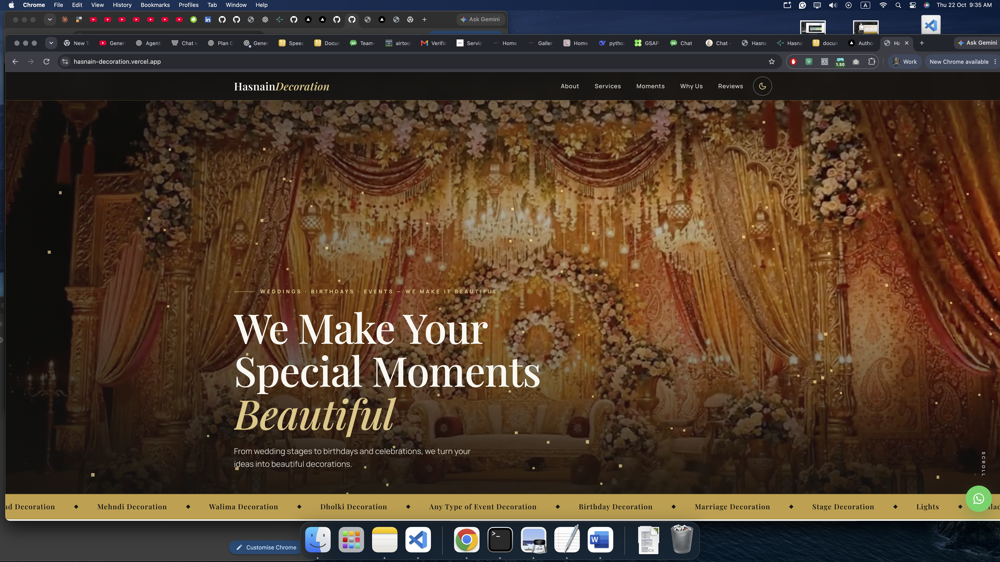
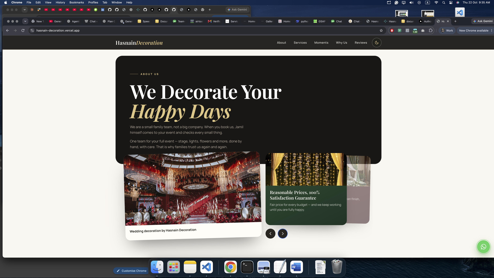
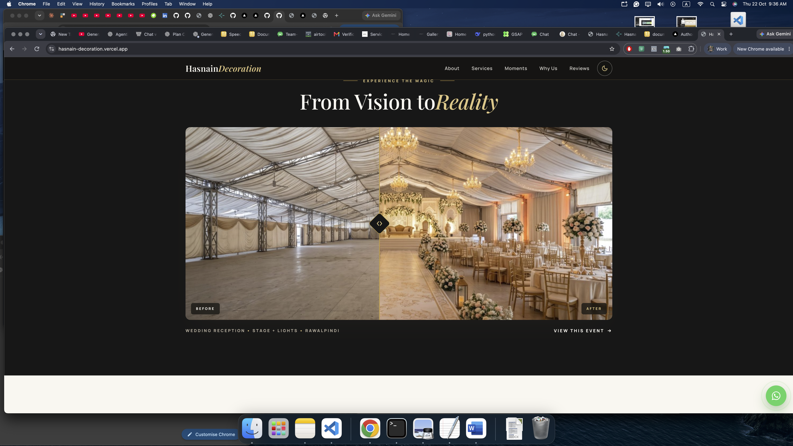
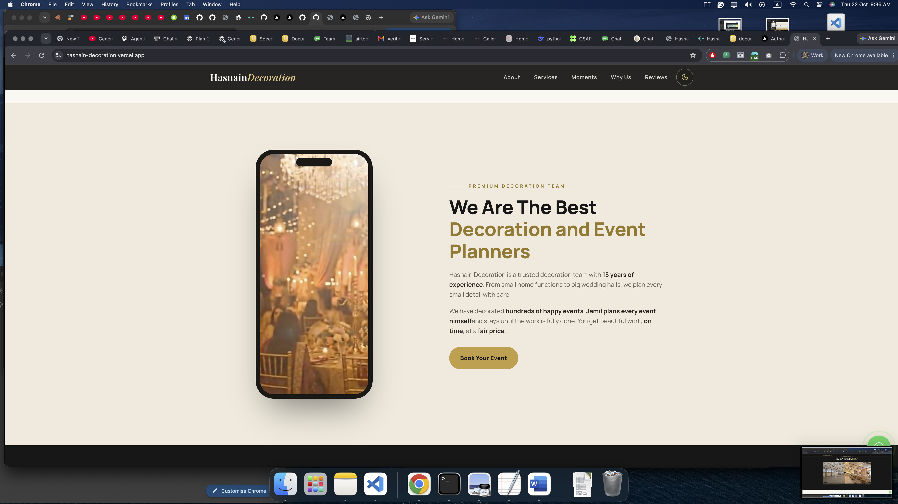
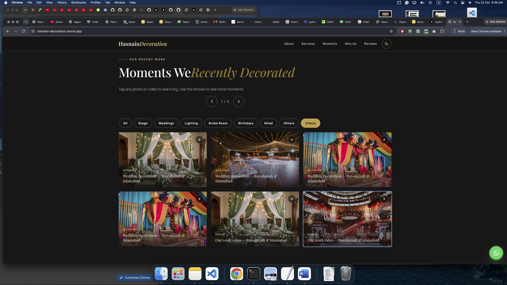
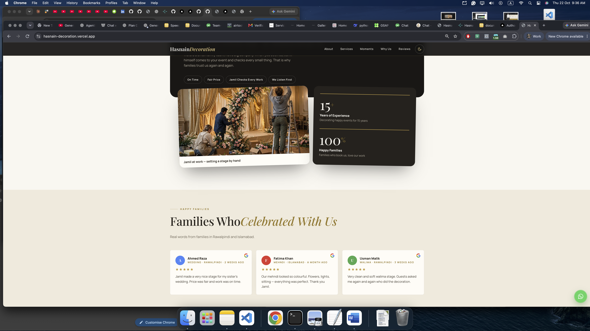

# 🎉 Hasnain Decoration — Event Decoration Website


**A fast, mobile-first business website for an event decoration team in Rawalpindi & Islamabad — real photos, videos, and one-tap WhatsApp booking.**


---

## 🚀 Project Overview

**Hasnain Decoration** is a small family team, run by Jamil, with **15 years of experience** in event decoration. This website helps families see the team's real work and book fast from their phones — most visitors come on mobile, so the site is made **phone-first** and loads fast even with many photos and videos.

The site has **3 pages**: Home, Our Work (gallery), and How We Work (4 simple steps from idea to final decoration). Services cover Wedding Stage Decoration, Marriage Decoration, Mehndi, Walima, Dholki, Birthday, Milad, Lights & Any Type of Event Decoration.

Built with **Next.js 14 (App Router)** on the frontend, **GSAP** for scroll animations, and **Three.js** for the golden dust effect in the hero. Hosted on **Vercel**.

🌐 **Live Website:** [hasnain-decoration.vercel.app](https://hasnain-decoration.vercel.app)

---

## ✨ What Users Can Do

<table>
<tr>
<td width="50%">

### 🏠 Home Page
- Watch the **hero video** with golden dust particles
- See **latest work** and **happy days** card slider
- Browse all **8 services** in a clean accordion
- Read **family reviews** in a slider
- Get answers from the **FAQ** section

</td>
<td width="50%">

### 🖼️ Our Work Page
- Browse the full **Moments Gallery**
- Filter by **Stage, Weddings, Lighting, Bridal Room, Birthdays, Milad, Others, Videos**
- Tap any item to **open it big** with arrows and captions
- Drag the **Before / After slider** to compare a plain hall vs a decorated hall
- Play **fast video previews** without slowing the page

</td>
</tr>
<tr>
<td width="50%">

### 📋 How We Work Page
- Follow **4 simple steps** from idea to final decoration
- Read how the team plans, sets up, and finishes every event
- See real **setup photos** from past events

</td>
<td width="50%">

### 🌙 Theme & Mobile Experience
- One-tap **Dark / Light mode** saved in the browser
- **Mobile-first design** — fast even with 50+ photos and videos
- **Phone Video Section** — a real stage video plays inside a phone frame
- Smooth **GSAP scroll animations** on every page

</td>
</tr>
<tr>
<td width="50%">

### 💬 One-Tap WhatsApp Booking
- **Floating WhatsApp button** on every page
- Booking buttons open WhatsApp with a **ready message**
- **Call button** for direct phone contact
- Facebook and TikTok links in the footer

</td>
<td width="50%">

### 📍 Find Us Section
- **5.0 rating card** with real family reviews
- **Map of Saddar, Rawalpindi** embedded
- Quick links to **Facebook + TikTok**
- Full contact details in one place

</td>
</tr>
</table>

---

## 📸 Screenshots

| Home Page — Hero | What we do|
| :---: | :---: |
|  |  |

| Before / After| Why We |
| :---: | :---: |
|  |  |

| Moments Gallery   | Reviews & Find Us |
| :---: | :---: |
|  |  |

---

## 🛠 Tech Stack

<div align="center">

### Frontend


### Animation & 3D


### Deployment


</div>

Built with **Next.js 14 (App Router), React 18, and TypeScript**. GSAP runs the scroll animations, Three.js runs the golden dust effect in the hero, and each page has its own CSS file. Hosted on **Vercel**.

---

## 📁 Project Structure

```text
Decoration-website/
├── public/
│   └── assets/                 # All photos & videos
│       ├── stage/
│       ├── weddings/
│       ├── lighting/
│       ├── bridal/
│       ├── birthday/
│       ├── milad/
│       ├── others/
│       ├── videos/
│       └── screenshots/        # README screenshots (1.png to 6.png)
│
├── src/
│   ├── app/                    # Pages: (home) → /, our-work, how-we-work
│   ├── components/
│   │   ├── home/               # Hero, Moments, Services, Reviews, FAQ
│   │   ├── our-work/           # Gallery, Before/After, Reviews
│   │   ├── how-we-work/        # Hero, Steps
│   │   └── GoldParticles.tsx   # Three.js golden dust effect
│   └── styles/                 # home.css, our-work.css, how-we-work.css
│
├── package.json
└── README.md
```

---

## 🚀 Quick Start & Installation

### Prerequisites

- **Node.js** (v18.x or higher)
- **Git**

### 1️⃣ Clone the Repository

```bash
git clone https://github.com/waleedkhokar/events-and-marriage-decoration.git
cd events-and-marriage-decoration
```

### 2️⃣ Install & Run

```bash
# Install dependencies
npm install

# Run the development server
npm run dev
```

The website will run locally at `http://localhost:3000`.

### 3️⃣ Build for Production

```bash
# Create the production build
npm run build

# Start the production server
npm start
```

---

## 👨‍💻 Developer

**Waleed Khokhar**

***Full-Stack AI Engineer***

Full-Stack Developer with 1+ year of experience building scalable **web applications** and **mobile apps (Android & iOS)** with AI-powered features. Specializing in intelligent AI solutions using **Generative AI, LLMs, Agentic AI, RAG, and LangChain automation**, alongside strong proficiency in **React Native, Next.js, and the MERN stack** for building modern, production-ready mobile & web apps.

## 🌐 Connect With Me

<div align="center">

[](https://waledkhokar.vercel.app/)
[](https://linkedin.com/in/waleedkhokhar)
[](https://github.com/waleedkhokhar)

</div>

---

## 📄 License

Currently a personal development and portfolio project. License terms to be defined prior to commercial deployment.

---

⭐ **If you liked this project, drop a ⭐ on the repo and share it with others!**
